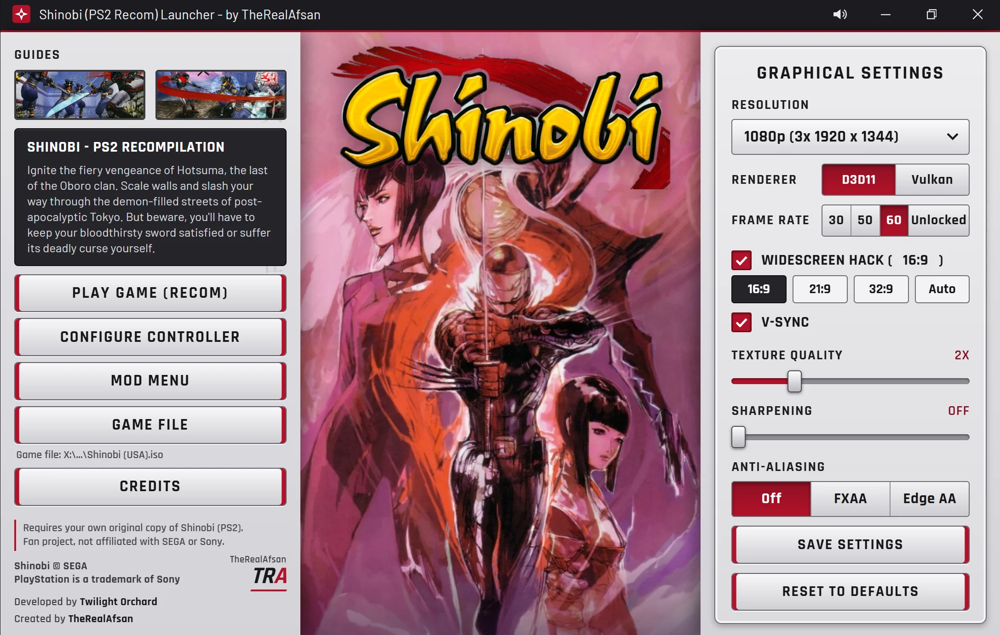
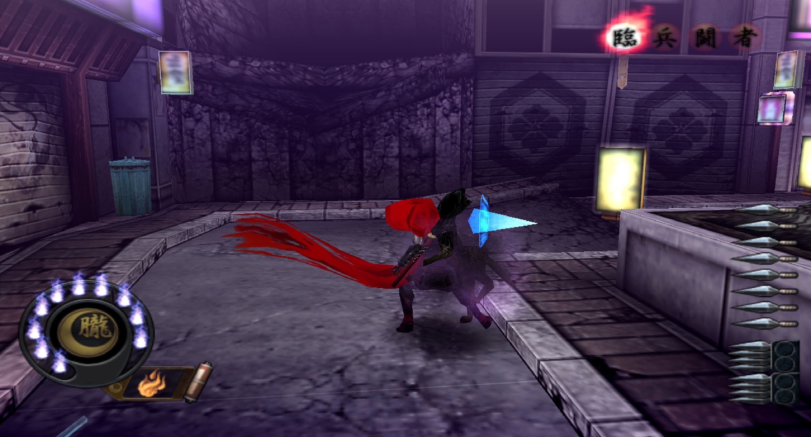
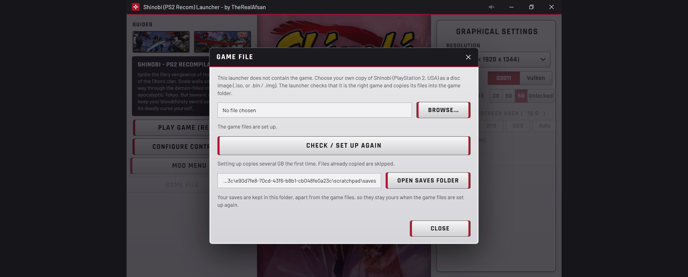
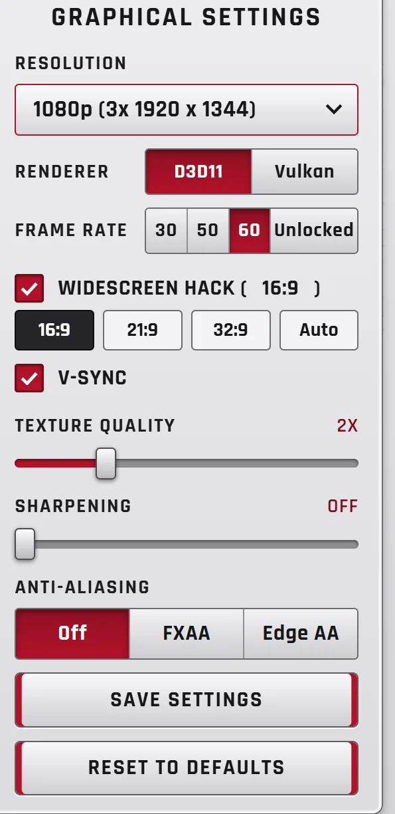
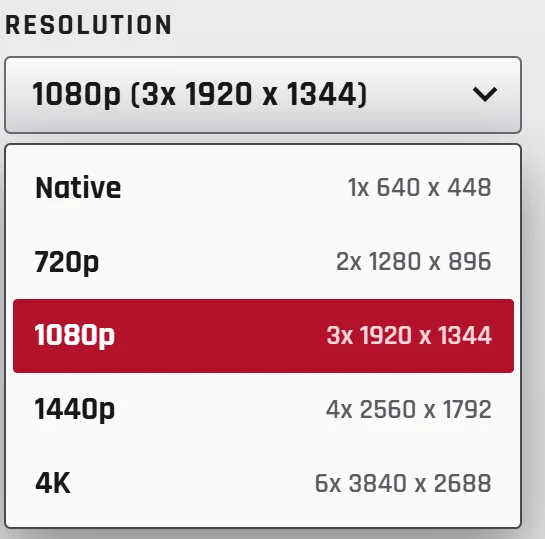
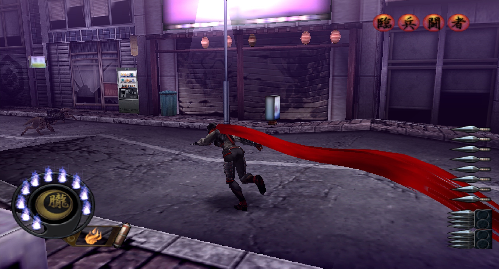
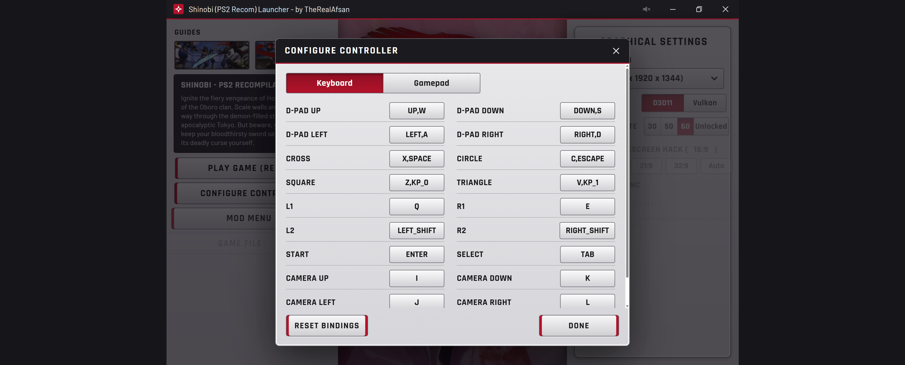
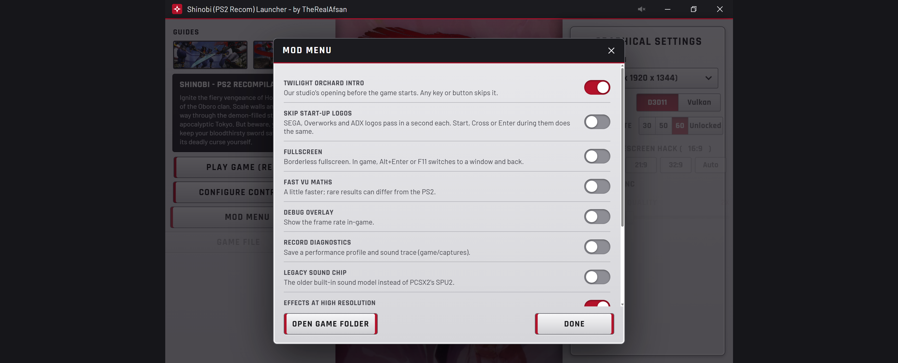
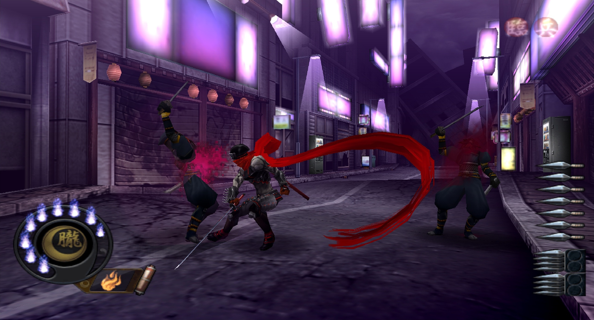
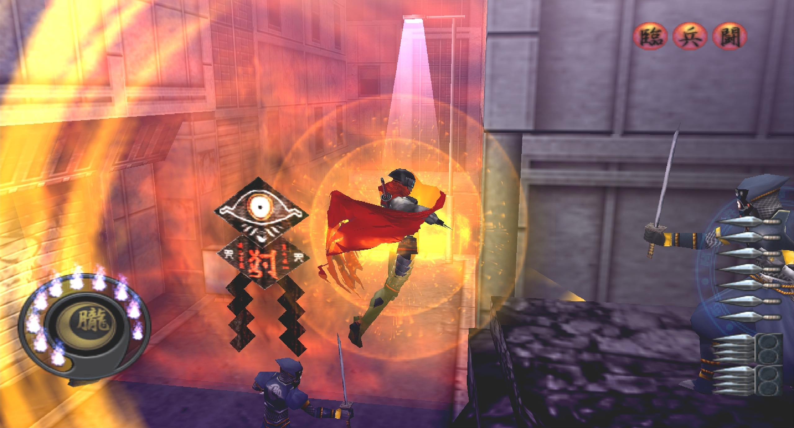

# Shinobi (PS2) Recomp

<a href="https://recomplauncher.com"><picture><source media="(prefers-color-scheme: dark)" srcset="https://recomplauncher.com/assets/press/launcher/badge-light.svg"></picture></a>

## Download and play

1. Click the green **Code** button above, then **Download ZIP**. When it has downloaded, right-click the file and choose **Extract All...** (any folder except Program Files). That is GitHub's own download, the only unzipping there is.
2. Run **`Shinobi Launcher.exe`** (it is in the main folder you just unzipped).
3. Press **Game File**, choose your own Shinobi (USA) disc image, press **Set up game files**, then **Play Game**.

Everything is in this one repository: the launcher, the game program and the source code.

> ### You must own the game
> Buy your own copy of **Shinobi (PlayStation 2, USA)** and make a disc image (`.iso`) from your own disc with a DVD drive and a disc-imaging tool. **This repository contains no game, no disc image and no game data**, and it never will. We do not provide, link to or help anyone find a copy of the game. No disc, no game.

---

A native Windows port of **Shinobi** (PlayStation 2, USA) by **TheRealAfsan**, [Twilight Orchard](https://www.youtube.com/@TheReal_Afsan).

YouTube: <https://www.youtube.com/@TheReal_Afsan>  
Reddit: <https://www.reddit.com/user/Afsan23/>

> **This repository does not contain the game.** No disc image, no game files and no game data. The launcher's artwork and music are the author's own. You need your own copy of Shinobi (PS2, USA, SLUS-20459), made into an image file from the disc you own.

## Shinobi PS2 recompiled v0.3: Early Access (patch notes)

It is playable. This is early access: expect bugs, and updates will follow (v0.4 is next).

The game's own program is translated ("recompiled") to run natively on Windows. PCSX2's graphics (GS) and sound (SPU2) code is used for the parts that have to match the PS2 exactly.

 Beautiful new launcher, with a wide range of options to your taste. Defaults: 1080p, D3D11, 60 fps, widescreen 16:9, V-Sync, 2x textures.

### Major fixes in short

1. **Sound** is much improved: the PCSX2 sound chip emulation is now the default (see the sound note below).
2. **Close to 60 fps**, with dips in close-ups that are normally unnoticeable.
3. **A launcher made for the game**, also reachable in game with the press of a button (F1).
4. **Now live on GitHub**, and submitted to RecompStore and Recomp Haven, awaiting approval.
5. **Twilight Orchard**, my video game development company, now has its own intro built into the game.

 Combat, running natively at 60 fps.

## What you need

- Windows 10 or 11, 64-bit
- A graphics card with Direct3D 11 (default) or Vulkan
- Microsoft Edge WebView2 Runtime (part of Windows 11)
- The Microsoft Visual C++ Redistributable (x64), which most PCs already have
- Your own disc image of Shinobi (USA), `.iso` (or `.bin` / `.img` with raw sectors)
- About 1.5 GB free space, plus saves

Developed on a Ryzen 7 9800X3D and a GeForce RTX 5080. The CPU is the main limit: more fast cores help most.

## Quick start

1. Start `Shinobi Launcher.exe`.
2. **Game File → Browse...** and choose your Shinobi (USA) disc image. The launcher checks it is the right game.
3. **Set up game files** copies the game's files out of your image into the `game` folder (about 1.2 GB, once).
4. **Play Game (Recom).**

The launcher remembers where your game file is and shows it under the Game File button.

 Game File: pick your own disc image, the launcher checks it and sets the game up for you.

## New launcher (built from my own design)

- Resolution: Native, 720p, 1080p, 1440p and 4K.
- Renderer: D3D11 or Vulkan.
- Widescreen with 16:9, 21:9, 32:9 and Auto.
- V-Sync, controller remapping, a Mod Menu, and fullscreen.
- Anisotropic filtering (Texture Quality) and a working Sharpening slider.
- Edge AA and FXAA.
- Launcher music with a mute button, entrance animations, and credits.
- About DLSS: not possible for this game, because DLSS needs motion data the PS2 never produced. Instead there are high internal resolutions (up to 6x), sharpening and anti-aliasing.

 
 A nice range of graphical settings you can tweak. Open the launcher any time in game with F1. / Up to 4K built-in upscaling.

## In-game

- A pause menu on F1 or Select+Start, in the same style as the launcher. It really pauses the game, works with a controller, and has Resume, Controller, Mods and Quit.
- Alt+Enter or F11 toggles between full screen and a proper window.
- A Twilight Orchard intro plays at startup, and the SEGA, Overworks and ADX logos can be skipped.
- The window's title bar shows live statistics: `FPS 60 | AVG 60 | 1% LOW 49 | CPU 4% | RAM 0.9 GB | VRAM 0.2 GB` (windowed mode). Nothing is drawn over the game.

 Well optimised: about 1 GB of RAM and 0.2 GB of VRAM on standard usage. You just need a good CPU.

## Controls

Everything can be changed in **Configure Controller** (and the in-game menu, F1).

| | Keyboard default |
|---|---|
| D-pad | Arrows or W A S D |
| Cross / Circle | X or Space / C or Escape |
| Square / Triangle | Z or Numpad 0 / V or Numpad 1 |
| L1 / R1, L2 / R2 | Q / E, Left Shift / Right Shift |
| Start / Select | Enter / Tab |
| Camera (right stick) | I K J L |

- **Mouse:** moves the camera; left click = Square, right click = Circle; **F10** switches it on and off.
- **Controllers:** DualSense, DualSense Edge, DualShock 4 and Xbox (360, One, Series) use the standard layout. Only the DualSense Edge is tested so far; is a controller not working for you? Let me know.
- **In game:** F1 or Select+Start = menu (pauses), Alt+Enter or F11 = window / full screen, F8 = mark a problem in the log.

 Full mouse, keyboard and controller support, Bluetooth or wired.

## Mod Menu

The **Mod Menu** has the studio intro, skipping the start-up logos, full screen, fast VU maths, diagnostics and more. It also has experimental effect settings (fog, glow and blur at high resolution) with switches to turn them off.

 A built-in Mod Menu too.

## Performance

- Fixed a bug where 10-15% of finished frames were thrown away before reaching the screen.
- The window no longer waits on the graphics thread every frame (about 9 ms of every 16.7).
- Frames are shown on an even beat, and the graphics thread does less copying per frame.
- The game's own code finishes a frame in about 6 ms of the 16.7 ms available.
- Frame-rate choices: 30, 50, 60 or Unlocked. Fixed V-Sync "off" being ignored at startup.

 Group fights stay smooth thanks to the CPU-heavy native build.

## Saves

Saves are kept in the `saves` folder next to the launcher, apart from the game files: `saves/mc0`, `saves/mc1`, and dated copies in `saves/backups`. Copy that folder to back up or move your saves.

## Sound note

The PCSX2 sound chip emulation is the default and fixed double-looping music and sounds that kept playing after you left a scene. The old sound code is still there as the "Legacy sound chip" option. The game's streamed music can still reach the sound chip with a damaged right channel (static in the right ear); until the cause is found, `audio.stereo_repair` in `game/settings.ini` plays the clean left channel in both ears (`copy_left`, default; Shinobi never had surround sound). Set it to `stereo` to turn the repair off.

## Known issues (fixes coming in v0.4)

- **Stage 2 has missing music; stage 3 onwards can have no sound.** To fix it: press F1, close the game, restart, and the sound returns.
- **Pre-rendered cutscenes do not render correctly after a certain point.**
- 21:9 onwards widescreen is experimental (a pink square when an enemy dies, and a possible crash). Use 16:9 for now.
- The frame rate can dip in the heaviest fights. It's a CPU-heavy build.
- The duo boss has some strange pink geometry around them.
- Some FPS drops on some levels, nothing crazy, just needs more optimisation.
- Pressing Escape no longer quits the game (it is Circle / cancel). Close with the window's X, Alt+F4 or the F1 menu's Quit.
- Only the DualSense Edge is tested; other controllers should work.

 Ninja magic.

Any issues? Complain as much as you like in the Issues tab or on Reddit, I read everything. Next up: version 0.4, then Nightshade or Tekken 4.

## Building from source

The source is GPL-3.0 (see `LICENSE`). The source repository does not contain the translated game code: it is generated from the game's own program file. The downloadable release contains it only inside the finished program (`bin/Shinobi.zip`, unpacked by the launcher by itself); it holds no game data. A step-by-step build guide is still to come. The runtime is in `devilkings-fork/ps2xRuntime`.

## Credits

- **Shinobi (PS2) Recomp:** TheRealAfsan, Twilight Orchard
- **PS2Recomp:** [ran-j](https://github.com/ran-j/PS2Recomp) and contributors
- **PCSX2** (graphics and sound code, GPL): the PCSX2 Team, <https://pcsx2.net>
- **raylib:** Ramon Santamaria and contributors, <https://www.raylib.com>
- **Microsoft Edge WebView2** shows the launcher page

See `THIRD_PARTY_NOTICES.txt`.

## Legal

An unofficial fan project, not made by, affiliated with or endorsed by SEGA or Sony. Shinobi and SEGA are trademarks of SEGA Corporation; PlayStation is a trademark of Sony Interactive Entertainment. You need your own legally obtained copy of the game. Free software under the GNU General Public License v3.0, with no warranty.
