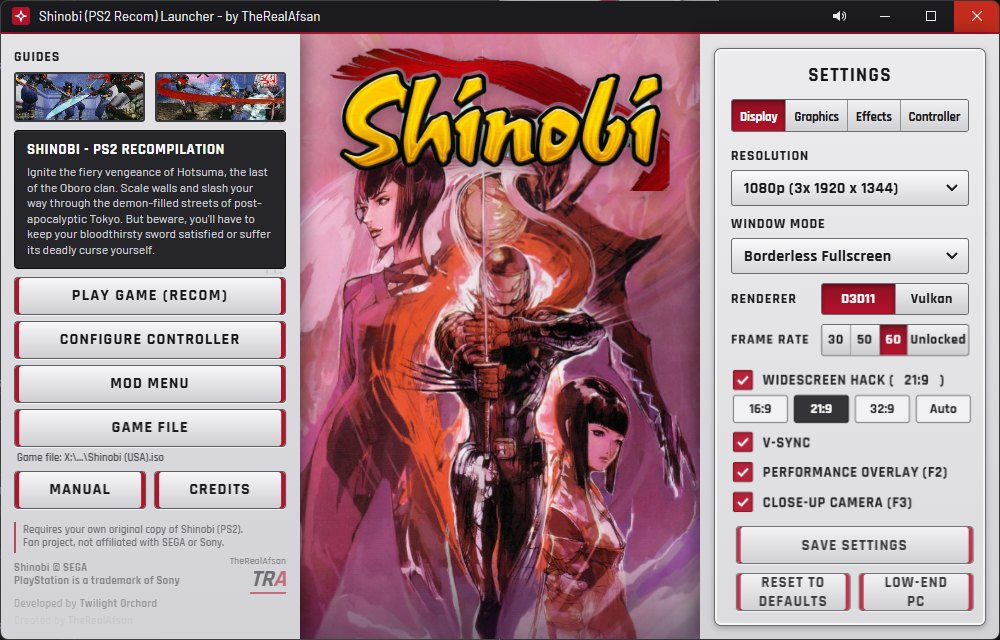
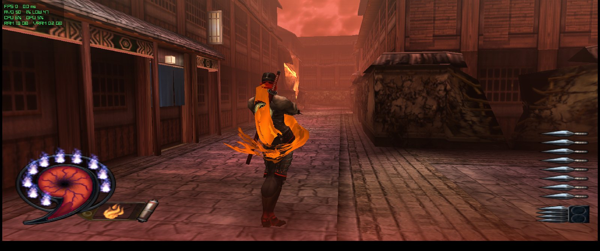
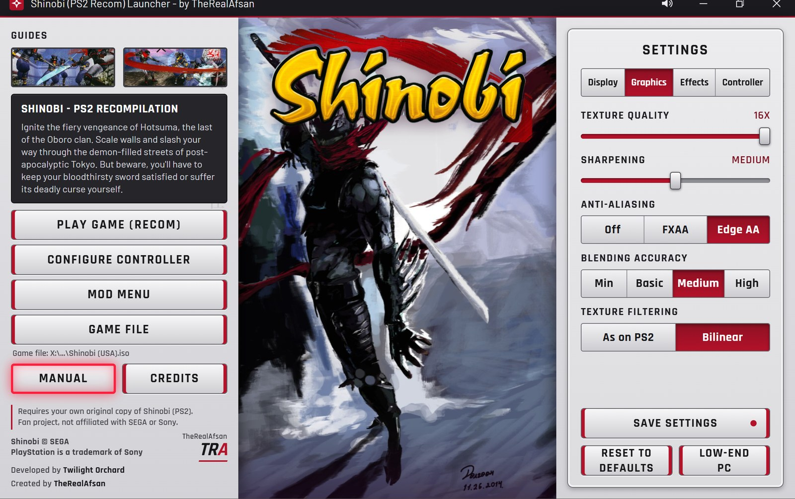
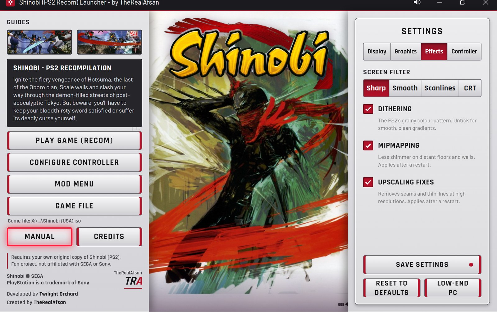
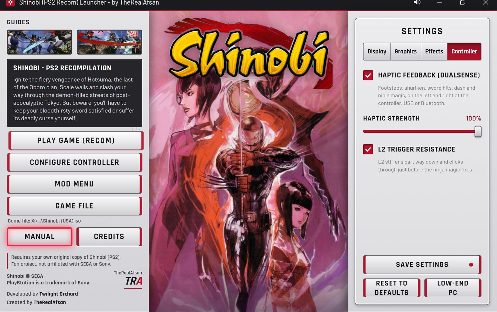
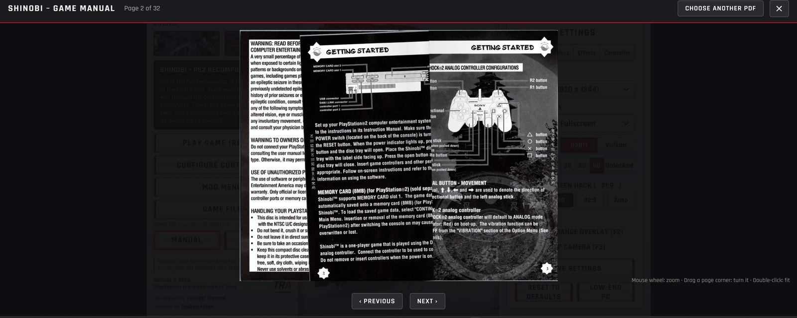
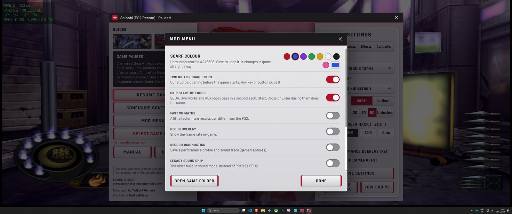
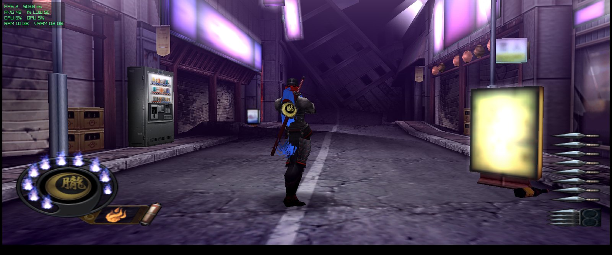
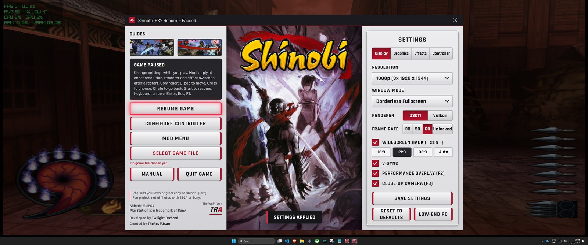

# Shinobi (PS2) Recomp

**v0.4 is out:** a brand-new launcher, mod support, DualSense HD haptics, a close-up camera, 8K and the game manual built in. 🔥

 The brand-new launcher: rotating artwork, settings in tabs, and fully playable with a controller.

## Download and play

1. Click the green **Code** button above, then **Download ZIP**. When it has downloaded, right-click the file and choose **Extract All...** (any folder except Program Files). That is GitHub's own download, the only unzipping there is.
2. Run **`Shinobi Launcher.exe`** (it is in the main folder you just unzipped).
3. Press **Game File**, choose your own Shinobi (USA) disc image, press **Set up game files**, then **Play Game**.

Everything is in this one repository: the launcher, the game program and the source code.

> ### You must own the game
> Buy your own copy of **Shinobi (PlayStation 2, USA)** and make a disc image (`.iso`) from your own disc with a DVD drive and a disc-imaging tool. **This repository contains no game, no disc image and no game data**, and it never will. We do not provide, link to or help anyone find a copy of the game. No disc, no game.

---

A native Windows port of **Shinobi** (PlayStation 2, USA) by **TheRealAfsan**, [Twilight Orchard](https://www.youtube.com/@TheReal_Afsan).

YouTube: <https://www.youtube.com/@TheReal_Afsan>  
Reddit: <https://www.reddit.com/user/Afsan23/>

> **This repository does not contain the game.** No disc image, no game files and no game data. You need your own copy of Shinobi (PS2, USA, SLUS-20459), made into an image file from the disc you own.

The game's own program is translated ("recompiled") to run natively on Windows. PCSX2's graphics (GS) and sound (SPU2) code is used for the parts that have to match the PS2 exactly.

---

## v0.4: the biggest update yet

v0.4 is here, as promised! Grab a drink.

### The big ones

1. **A brand-new launcher.** New rotating artwork, settings in tabs, a proper Shinobi icon, a resizable window that snaps 50/50, and you can drive the whole thing with a controller.
2. **Mod support.** Change Hotsuma's scarf to any colour you like, live, plus a new close-up camera mod, all switchable in game.
3. **Full DualSense HD haptics, wired AND wireless.** Every footstep left and right, every shuriken, every sword hit, and an L2 trigger that clicks before your magic fires.
4. **A close-up, over-the-shoulder camera (F3)** for more intimate combat. It glides in and glides back out.
5. **The original game manual, built in.** It has real page-turning and zoom, and **F4** in game slides it up over the action.
6. **Performance overlay (F2):** FPS, frame time, 1% lows, CPU, GPU, RAM and VRAM, NVIDIA-style.
7. **Big performance work:** geometry now runs across multiple CPU cores, the sound chip is 30% cheaper, and there's a new Low-end PC preset.
8. **8K resolution** and a whole set of new graphics options.
9. **Change settings live in game with F1.** Most no longer need a restart.
10. **The missing cutscenes are fixed.**
11. **Recomp Store / RecompLauncher:** approved developer, with support coming soon (submission in progress).

 The new close-up camera (F3) and an orange scarf, picked live from the Mod Menu.

### Brand-new launcher

- New rotating artwork behind the logo, crossfading every few seconds.
- Settings in tabs: **Display, Graphics, Effects, Controller**.
- Fully playable with a controller:
  - D-pad or stick moves, ✕ picks, ○ goes back, L1/R1 switches tabs.
  - A clear red highlight shows where you are.
- The window resizes, maximises and snaps (50/50 with another window).
- Window Mode: Borderless, Exclusive Fullscreen or Windowed.
- The original Shinobi manual, with page-flip animation, mouse-wheel zoom and controller page-turning.
- A Game File checklist plus an "I own this copy" tick, so you know your disc image is right.
- A proper Shinobi icon on the launcher and the game.
- It checks your CPU supports AVX2 and tells you if it doesn't.

<table>
<tr>
<td width="50%"> <b>Graphics:</b> texture quality, sharpening, anti-aliasing, blending accuracy, texture filtering.</td>
<td width="50%"> <b>Effects:</b> screen filter (Sharp / Smooth / Scanlines / CRT), dithering, mipmapping, upscaling fixes.</td>
</tr>
<tr>
<td width="50%"> <b>Controller:</b> DualSense haptics, haptic strength, L2 trigger resistance.</td>
<td width="50%"> <b>The original manual,</b> built in, with real page-turning and zoom. F4 in game.</td>
</tr>
</table>

### Mod support

- **Scarf colour:** pick any colour for Hotsuma's scarf from a colour picker. It changes live while you play.
- **Close-up camera:** an over-the-shoulder view (below).
- Mods live in the Mod Menu and the F1 menu, so you can switch them on the fly.
- This is the foundation for more mods to come. Tell me what you want next 👀

<table>
<tr>
<td width="50%"> The Mod Menu with the scarf colour picker.</td>
<td width="50%"> Hotsuma in a blue scarf.</td>
</tr>
</table>

### DualSense HD haptics (DualSense and DualSense Edge)

I didn't want "rumble". I wanted it to feel like a modern PS5 game, so I built it from scratch, timed to the animations frame by frame.

- Walking is light left/right taps, and running is heavier.
- Each shuriken throw pushes on the side of the throwing hand.
- Sword swings are strong, and landing a hit is a heavy thud.
- The dash is a run of taps that travels across the controller.
- The ○○△ shuriken storm is an electric crackle the moment the shuriken leave his hands.
- **Ninja magic:** L2 stiffens, you push through the click, and the whole controller swells as it fires. No more wasting magic with a light touch.
- It works over **USB and Bluetooth**, with a strength slider and on/off switches in the launcher.

### Close-up camera (F3)

- Press **F3** and the camera pushes in behind Hotsuma's shoulder, easing in rather than teleporting. Press F3 again to ease back out.
- It steps aside automatically when you lock on with R1, so the two never fight.
- It's also a switch in the launcher.

### Performance

- Geometry runs across multiple CPU cores.
- The sound processor is about **30% cheaper** and stays steady in long sessions.
- New **Low-end PC** preset for slower machines.
- **Performance overlay on F2**, so you can see exactly where you stand.

### Graphics

- **8K** (12×) internal resolution.
- Most settings change in game with F1, no restart needed.
- New options:
  - Blending Accuracy
  - Texture Filtering
  - Screen Filter (Sharp / Smooth / Scanlines / CRT)
  - Dithering
  - Mipmapping
  - Upscaling Fixes

 The F1 menu over the game: change settings and mods live, then carry on playing.

### In game

| Key | |
|---|---|
| **F1** (or Select+Start) | Menu: settings, mods and controller, all live (pauses the game) |
| **F2** | Performance overlay |
| **F3** | Close-up camera |
| **F4** | The game manual |
| **Alt+Enter / F11** | Window or full screen |

Pressing F2 or F3 slides a little notice down in the corner, so you know it's on or off.

### Fixes

- The missing cutscenes are fixed.
- Controllers work even with Steam Input or other virtual pads connected.
- The F1 menu always responds to the controller.
- The game starts in fullscreen properly.
- Fixed a crash in ultrawide.

### Known issues

- The duo boss's projectiles still show pink boxes.
- The frame rate can dip in the heaviest fights on slower CPUs. Full multi-thread support is in, so there should be gains on lower-end CPUs too.
- Haptics are tested on the DualSense Edge; the standard DualSense should behave the same.
- In rare cases, a cutscene that is rushed while loading can show missing textures.

Any issues? Tell me in the Issues tab or on Reddit, I read everything and I'll fix it.

---

## What you need

- Windows 10 or 11, 64-bit
- A processor with AVX2: Intel Core 4th generation (2013) or newer, or AMD Ryzen. Celeron, Pentium and Atom chips usually do not have it, and the launcher will tell you
- A graphics card with Direct3D 11 (default) or Vulkan
- Microsoft Edge WebView2 Runtime (part of Windows 11)
- The Microsoft Visual C++ Redistributable (x64), which most PCs already have
- Your own disc image of Shinobi (USA), `.iso` (or `.bin` / `.img` with raw sectors)
- About 1.5 GB free space, plus saves
- For HD haptics: a DualSense or DualSense Edge (USB or Bluetooth)

Developed on a Ryzen 7 9800X3D and a GeForce RTX 5080. The CPU is the main limit: more fast cores help most.

## Quick start

1. Start `Shinobi Launcher.exe`.
2. **Game File → Browse...** and choose your Shinobi (USA) disc image. The launcher checks it is the right game.
3. **Set up game files** copies the game's files out of your image into the `game` folder (about 1.2 GB, once).
4. **Play Game (Recom).**

The launcher remembers where your game file is and shows it under the Game File button.

## Controls

Everything can be changed in **Configure Controller** (and the in-game menu, F1).

| | Keyboard default |
|---|---|
| D-pad | Arrows or W A S D |
| Cross / Circle | X or Space / C or Escape |
| Square / Triangle | Z or Numpad 0 / V or Numpad 1 |
| L1 / R1, L2 / R2 | Q / E, Left Shift / Right Shift |
| Start / Select | Enter / Tab |
| Camera (right stick) | I K J L |

- **Mouse:** moves the camera; left click = Square, right click = Circle; **F10** switches it on and off.
- **Controllers:** DualSense, DualSense Edge, DualShock 4 and Xbox (360, One, Series) use the standard layout. The DualSense Edge is the one tested; is a controller not working for you? Let me know.
- **In game:** F1 or Select+Start = menu (pauses), F2 = performance overlay, F3 = close-up camera, F4 = manual, Alt+Enter or F11 = window / full screen, F8 = mark a problem in the log.

## Saves

Saves are kept in the `saves` folder next to the launcher, apart from the game files: `saves/mc0`, `saves/mc1`, and dated copies in `saves/backups`. Copy that folder to back up or move your saves.

## Sound note

The PCSX2 sound chip emulation is the default. The old sound code is still there as the "Legacy sound chip" option. `audio.stereo_repair` in `game/settings.ini` plays the clean left channel in both ears (`copy_left`, default; Shinobi never had surround sound). Set it to `stereo` to turn the repair off.

## Previous versions

The v0.3 patch notes are in [the README as it was at v0.3](https://github.com/TheRealAfsan/Shinobi-PS2-Recomp/blob/c059256/README.md).

## Building from source

The source is GPL-3.0 (see `LICENSE`). The source repository does not contain the translated game code: it is generated from the game's own program file. The downloadable release contains it only inside the finished program (`bin/Shinobi.zip`, unpacked by the launcher by itself); it holds no game data. A step-by-step build guide is still to come. The runtime is in `devilkings-fork/ps2xRuntime`.

## Credits

- **Shinobi (PS2) Recomp:** TheRealAfsan, Twilight Orchard
- **PS2Recomp:** [ran-j](https://github.com/ran-j/PS2Recomp) and contributors
- **PCSX2** (graphics and sound code, GPL): the PCSX2 Team, <https://pcsx2.net>
- **raylib:** Ramon Santamaria and contributors, <https://www.raylib.com>
- **Microsoft Edge WebView2** shows the launcher page
- **StPageFlip** (page-turning in the manual, MIT): Nodlik, <https://github.com/Nodlik/StPageFlip>
- **DualSense Bluetooth haptics:** the report format was worked out by [SAxense](https://github.com/egormanga/SAxense) and documented by [dualsense-bt-haptics](https://github.com/awalol/dualsense-bt-haptics); this port's implementation is its own

See `THIRD_PARTY_NOTICES.txt`.

## Legal

An unofficial fan project, not made by, affiliated with or endorsed by SEGA or Sony. Shinobi and SEGA are trademarks of SEGA Corporation; PlayStation is a trademark of Sony Interactive Entertainment. You need your own legally obtained copy of the game. Free software under the GNU General Public License v3.0, with no warranty.
